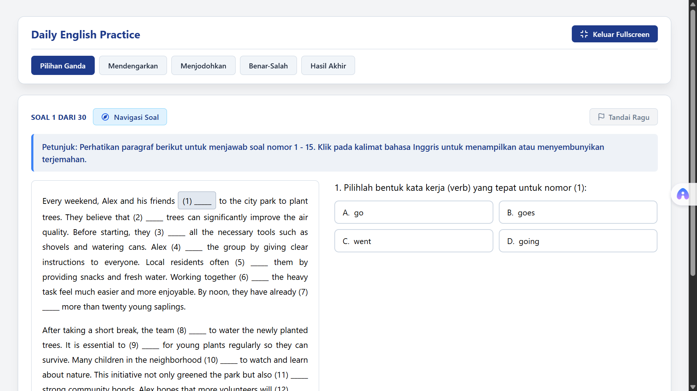

# Daily English Practice

Daily English Practice adalah aplikasi web untuk latihan bahasa Inggris berbasis kuis. Aplikasi ini menyediakan beberapa mode latihan seperti pilihan ganda, mendengarkan (listening), menjodohkan kata/kalimat, dan soal benar-salah, serta dilengkapi sistem navigasi soal, pembahasan, dan rekapitulasi skor.

## Fitur Utama

- **5 Mode Tab**: Navigasi antarmoda kuis tanpa perlu memuat ulang halaman.
- **Pengaturan Kecepatan Audio**: Pemutar audio pada kuis listening dengan opsi kecepatan 1.0x dan 0.75x.
- **Generator Audio TTS**: Skrip Python berbasis Edge-TTS untuk menghasilkan berkas audio latihan listening secara otomatis.
- **Transkrip dan Pembahasan**: Menampilkan teks pengucapan, terjemahan, serta penjelasan jawaban.
- **Drawer Navigasi Soal**: Panel samping untuk memilih nomor soal dan melihat status jawaban (Sedang Dibuka, Sudah Dijawab, atau Ragu-ragu).
- **Mode Layar Penuh**: Opsi tampilan fullscreen saat mengerjakan kuis.
- **Ringkasan Skor**: Perhitungan nilai per kategori dan total persentase di akhir kuis.
- **Pengelolaan Soal**: Soal dapat ditambah atau diubah secara mandiri melalui berkas JavaScript di dalam folder `data/`.

## Mode Kuis

| Mode Kuis | Deskripsi | Jumlah Soal Default |
| :--- | :--- | :---: |
| **Pilihan Ganda** | Soal tata bahasa dan membaca dengan opsi pilihan ganda dan pembahasan | 30 Soal |
| **Mendengarkan (Listening)** | Soal berbasis audio dengan transkrip dan terjemahan | 5 Soal |
| **Menjodohkan (Match)** | Mencocokkan kata, frasa, atau kalimat | 10 Soal |
| **Benar-Salah (True/False)** | Menentukan kebenaran dari pernyataan yang diberikan | 10 Soal |
| **Hasil Akhir** | Ringkasan skor per kategori dan opsi mengulang kuis | - |

## Struktur Proyek

    daily-english-practice/
    │
    ├── index.html                # Berkas utama antarmuka web
    ├── generate_audio.py         # Skrip Python pembuat berkas audio (Edge-TTS)
    │
    ├── audio/                    # Direktori penyimpanan berkas audio MP3
    │   ├── audio_1.mp3
    │   └── ...
    │
    ├── css/
    │   ├── variables.css         # Variabel warna dan tema CSS
    │   └── style.css             # Gaya tampilan dan tata letak aplikasi
    │
    ├── config/
    │   └── quizConfig.js         # Konfigurasi dasar kuis
    │
    ├── data/
    │   ├── pg-data.js            # Data soal Pilihan Ganda
    │   ├── english_listening.js  # Data soal dan file audio Listening
    │   ├── match-data.js         # Data soal Menjodohkan
    │   └── tf-data.js            # Data soal Benar-Salah
    │    
    ├── images/
    │   ├── image1                # gambar 1 aplikasi
    │   └── image2                # gambar 2 aplikasi
    │
    └── js/
        ├── widgets.js            # Fungsi UI (Fullscreen dan Navigation Drawer)
        ├── module-pg.js          # Logika kuis Pilihan Ganda
        ├── listening.js          # Logika pemutar audio dan kuis Listening
        ├── module-match.js       # Logika kuis Menjodohkan
        ├── module-tf.js          # Logika kuis Benar-Salah
        └── app.js                # Inisialisasi aplikasi dan pengolahan state

## Teknologi dan Dependensi

- **Web Frontend**: HTML5, CSS3, JavaScript (Vanilla ES6).
- **Audio Generator**: Python 3.x, `edge-tts`, `asyncio`.

## Cara Menambahkan atau Mengubah Soal

Untuk menambahkan atau mengubah daftar soal, berkas JavaScript di dalam folder `data/` dapat disunting secara langsung:

1. **Pilihan Ganda (`data/pg-data.js`)**: Ubah atau tambahkan objek soal yang berisi teks pertanyaan, pilihan jawaban, kunci jawaban, dan pembahasan.
2. **Mendengarkan (`data/english_listening.js`)**: Sesuaikan teks pertanyaan, jalur audio, dan pilihan jawaban. Jika menambahkan item audio baru, tambahkan juga teksnya ke skrip `generate_audio.py` agar berkas audio MP3 baru dibuat.
3. **Menjodohkan (`data/match-data.js`)**: Ubah atau tambahkan pasangan kata/kalimat yang ingin dicocokkan.
4. **Benar-Salah (`data/tf-data.js`)**: Ubah atau tambahkan pernyataan beserta status kebenarannya (true/false) dan penjelasannya.

## Cara Menjalankan Aplikasi

1. **Membuat Berkas Audio (Opsional)**
   Instal dependensi `edge-tts` lalu jalankan skrip pembuatan audio:
   ```bash
   pip install edge-tts
   python generate_audio.py
   ```

2. **Clone Repository**
   ```bash
   git clone [https://github.com/username/daily-english-practice.git](https://github.com/username/daily-english-practice.git)
   ```

3. **Buka Aplikasi**
   Buka berkas `index.html` menggunakan peramban web (browser) atau ekstensi Live Server di VS Code.

4. **Penggunaan**
   - Pilih mode kuis melalui tab navigasi di bagian atas.
   - Gunakan panel Navigasi Soal untuk berpindah nomor.
   - Pilih tab Hasil Akhir setelah selesai untuk melihat rincian skor.




*Catatan: Dokumentasi ini dibuat dengan bantuan AI (Created with AI assistance).*
